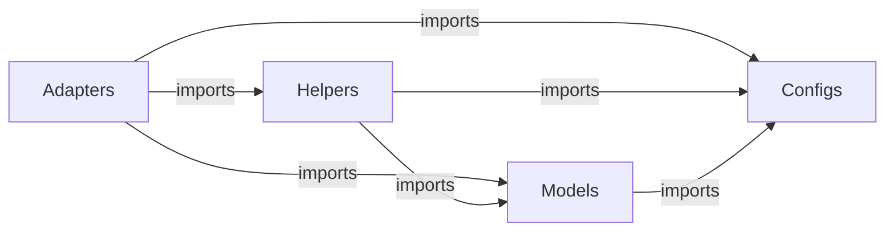

<div class="docs-home" markdown="1">

<div class="docs-home-hero" markdown="1">
<div markdown="1">

# Build with ArchiPy { #get-started }

Build Python services with typed adapters for databases, caches, and queues.

[Start the quickstart](getting-started/quickstart.md){ .md-button .md-button--primary }

</div>
<div class="docs-home-install" markdown="1">

## Install ArchiPy { #in-30-seconds }

Python 3.14 or later

```bash
uv add archipy
```

</div>
</div>

<div class="grid cards docs-entry-grid" markdown="1">

-   **[Installation](getting-started/installation.md)**

    Choose extras and set up your environment.

-   **[Tutorials](tutorials/index.md)**

    Connect an adapter or add an application feature.

-   **[API Reference](api_reference/index.md)**

    Look up public classes, configuration, and helpers.

</div>

## Why Use ArchiPy?

- Install each integration as an optional extra.
- Validate environment variables, `.env` values, and runtime overrides with `BaseConfig`.
- Use adapter interfaces to keep your business logic independent of clients and test against real services with testcontainers.

See [Concepts](getting-started/concepts.md) for a detailed comparison of ArchiPy against plain FastAPI and Django.

## What ArchiPy Offers

ArchiPy is organized into four layers:

- **Configs** — Type-safe, environment-based configuration via `pydantic_settings.BaseSettings`
- **Models** — Entities (SQLAlchemy), DTOs (Pydantic), Errors, and Types — data structures only, no I/O
- **Helpers** — Pure utilities: decorators (retry, cache, atomic), interceptors (rate limiting, tracing), JWT, password,
  date utils
- **Adapters** — Plug-and-play integrations: PostgreSQL, MySQL, SQLite, StarRocks, Redis, Kafka, Keycloak, MinIO,
  ScyllaDB,
  Elasticsearch, Temporal, Email, Payment Gateways

## Architecture Overview

Dependencies flow strictly inward — adapters may import from any inner layer, but inner layers never import outward:



See [Concepts](getting-started/concepts.md) for the full architectural breakdown.

> **Tip:** See the [Tutorials](tutorials/index.md) section for complete, runnable examples for every adapter and helper.

## Next Steps

- [Concepts](getting-started/concepts.md) — understand the Clean Architecture layers and design philosophy
- [Project Structure](getting-started/project_structure.md) — organize your application layers
- [Complete Example](getting-started/complete_user_example.md) — follow a feature through the stack
- [FAQ](community/faq.md) — answers to common questions
- [Contributing](community/contributing.md) — set up a dev environment and contribute to ArchiPy

</div>
